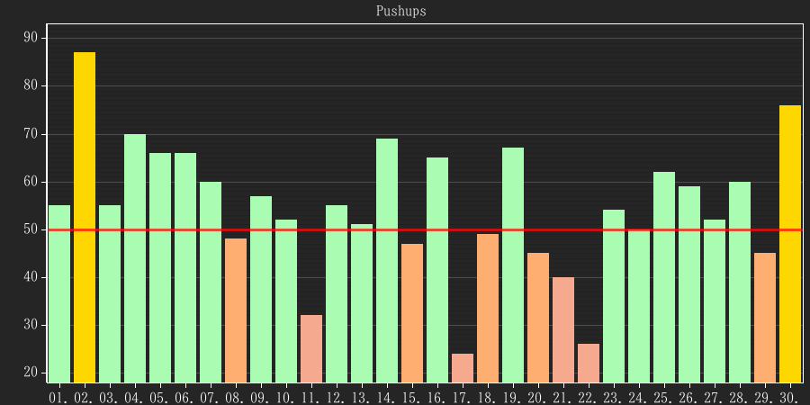
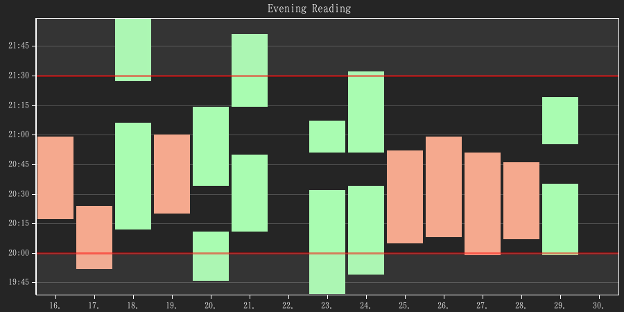
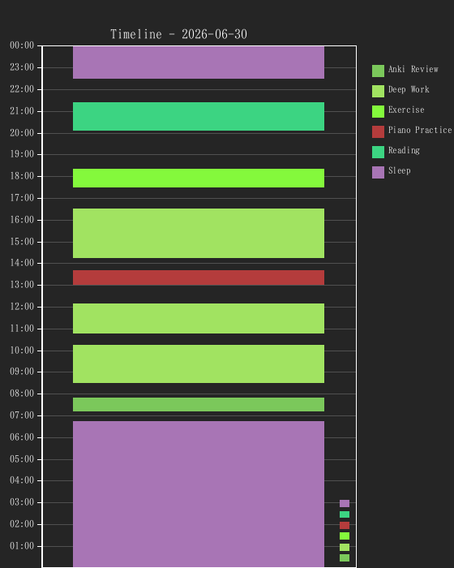

# LifeStats

A personal observability platform: every habit, work session, and wellness metric I care about is captured automatically from the tools where it happens — Anki, an e-book reader, mpv, a MIDI keyboard, a browser extension, Fitbit — flows through one Rust HTTP API into SQLite, and comes back out as goal-scored plots, streaks, and trend analysis.

<p align="center">
  
</p>
<p align="center">
  </p>
<p align="center"><em>Rendered by the actual plotting code from synthetic data — regenerate with <code>cargo run -p lifestats-plotting --example readme_images</code>.</em></p>

## What it does

- **Capture from where the activity happens.** Eight channels feed the same API:
  - **Anki add-on** (Python) — hooks review events; provisions five statistics per deck (time spent, disruptions, backlog, finish time, cards studied)
  - **E-book reader** (Svelte/TypeScript, vendored fork of the ttu reader) — reading time via heartbeats plus per-book character-position checkpoints
  - **Browser extension** (Vue 3, vendored fork of Web Activity Time Tracker) — active-tab time per domain, synced every 20 s
  - **mpv Lua script** — watch time for configured directories via ~1 Hz heartbeats
  - **MIDI logger** (Rust, workspace member) — piano practice time from note-on events, with idle timeout
  - **Fitbit sync** — OAuth flow + data client with retry/backoff, driven daily by a systemd timer
  - **Interactive stopwatch** (Rust TUI) + a DBus service exposing stopwatch state to taskbar widgets
  - **Plain HTTP** — anything else, including a TypeScript client (`clients/lifestats-js`, Zod-validated) that also runs in Obsidian
- **Score everything against goals.** Per-day goal resolution with precedence (daily override → suppression → default), then derived analytics: streaks, consistency scores, mean achievement, and an EWMA-based trend (fast/slow span crossover) per statistic.
- **Heartbeat sessions.** Loggers don't manage state; they ping `POST /sessions/{id}/beat` and the server accumulates time frames with idle-timeout and periodic flush (one active session per statistic, enforced).
- **Progress items.** A second bounded context for bounded work (books, courses): absolute checkpoints with idempotent external-source IDs, targets, completion summaries, and daily deltas — this is what the e-book reader feeds.
- **Visualize.** Stateless server-side rendering with [plotters](https://github.com/plotters-rs/plotters): bar/line/scatter charts, time-frame plots, and a daily timeline, colored by goal achievement. A wallpaper updater subscribes to change events and composites the plots into the desktop background.

<p align="center">
  
</p>

## HTTP API

An [Axum](https://github.com/tokio-rs/axum) server (`core/infrastructure/web_api`, binds `0.0.0.0:3000`) exposes 35 routes across 8 modules: statistics CRUD + logging, goals, sessions, progress items, plots (PNG and JSON), a multi-statistic dashboard, daily summaries, and integrations (Anki/ebook provisioning, Fitbit OAuth + sync). Migrations run automatically on startup.

Full route reference with DTO shapes and error mapping: [`core/infrastructure/web_api/README.md`](core/infrastructure/web_api/README.md). Integration guide for third-party clients: [`docs/web-api-integration.md`](docs/web-api-integration.md).

## Architecture

Ports & Adapters (hexagonal) with CQRS — dependencies always point inward toward the domain:

- **`core/core`** — pure domain, zero external dependencies. Six statistic types split at compile time into **logable** (`Habit`, `IntegerAmount`, `PointInTime`, `TimeSpans` — implement `Logable`) and **derived** (`SummingStatistic`, `TimeDifference` — implement `Computable`); you cannot log to a derived statistic. Goals, update policies, and streak evaluation are pure methods on domain types.
- **`core/application`** — command/query handlers under `use_cases/{commands,queries}/`, kept thin; reusable calculation services (goal resolution, EWMA, achievement evaluation) live beside them. Ports are traits; tests mock them with `mockall`.
- **`core/infrastructure`** — adapters: SQLite via Diesel (r2d2 pool, WAL, 14 embedded migrations), the Axum API, the plotters renderer, the Fitbit client, a system clock.
- **`lifestats-bootstrap`** — composition root; every binary calls `build_services()` and gets the wired dependency graph.
- **Events** — `ValueUpdated` / `GoalUpdated` / `NewDay` published over a Unix domain socket; the wallpaper updater re-renders on change.

The workspace has 10 member crates, ~29k lines of Rust, and ~370 tests — including a backward-compatibility test that verifies current code can still read older database snapshots (`just test-db-compat`). Logger applications and UIs (`ui/web-ui` is a Next.js 15 dashboard) live outside the workspace and build separately.

```
lifestats/
├── core/
│   ├── core/                  # Domain (zero deps)
│   ├── application/           # CQRS use cases + services
│   ├── plot-domain/           # Renderer-agnostic plot model
│   └── infrastructure/
│       ├── persistence/       # Diesel/SQLite + migrations
│       ├── web_api/           # Axum server
│       ├── plotting/          # plotters renderer
│       ├── fitbit_client/     # OAuth + data client
│       └── system_clock/
├── lifestats-bootstrap/       # Composition root
├── logger_applications/       # Anki, ebook, MIDI, mpv, stopwatch, browser
├── events/                    # Event types + Unix-socket transport
├── clients/lifestats-js/      # TypeScript API client
├── ui/                        # web-ui (Next.js), wallpaper updater
└── systemd/                   # Service units + Fitbit sync timer
```

## Running it

```bash
export DATABASE_URL=/path/to/lifestats.db   # or put it in .env
cargo run -p lifestats-web-api               # binds 0.0.0.0:3000, runs migrations
curl http://localhost:3000/statistics
```

Tests: `cargo test --workspace` (or `just test`). Lint/format: `cargo clippy`, `cargo fmt`.

For always-on operation, `systemd/` ships user-level units for the API, the web UI, and a daily Fitbit sync timer — see [`systemd/README.md`](systemd/README.md).

## Further reading

- [`docs/ARCHITECTURE.md`](docs/ARCHITECTURE.md) — layer rules and rationale
- [`docs/statistics.md`](docs/statistics.md) — the statistic type system
- [`docs/goal-overrides.md`](docs/goal-overrides.md) — goal precedence semantics
- [`docs/plans/progress-items-architecture-adr.md`](docs/plans/progress-items-architecture-adr.md) — ADR for the progress-items bounded context
- [`logger_applications/AnkiLogger/INTEGRATION.md`](logger_applications/AnkiLogger/INTEGRATION.md) — how a capture channel is built end-to-end

## License

[MIT](LICENSE)
