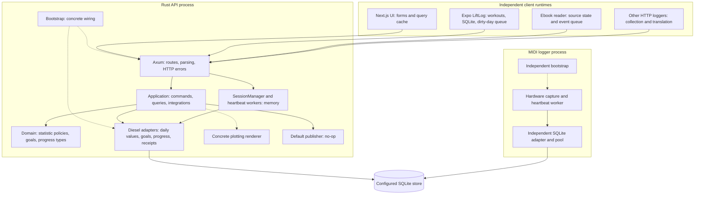

# Lifestats architecture grounding

## Overview

Scope: analysis for one user, multiple devices/loggers, cached mobile reads and durable queued offline writes. No implementation or live-state changes. Source baseline/HEAD: `06e4e70888b2fca062e3fdf2fd6fed60fd39d389`; deployed executable revision **unknown**. [B]

Evidence labels: **M** = Direct, inspected source mechanics; **I** = Direct, explicit recorded intent; **R** = Inferred consequence, not a reproduced incident; **U** = Unknown. Priorities concern the confirmed brief.

**I:** Lifestats protects product rules behind inward-facing ports; CQRS moves input parsing into adapters and constructs handlers on demand. **M:** The implementation combines useful pure calculations with broadly exposed repositories, integration services and process-local workers. HTTP is one entry point; the active MIDI logger also constructs SQLite-backed services independently. **R:** Consequently, exclusive server write ownership is not implemented. [A][C][D]

**R:** The central preparation issue appears to be consistency across these boundaries, rather than replacing SQLite or the domain model. A durable client queue alone cannot establish atomic server effects, duplicate detection, source ownership or stale-write rejection; current paths provide different subsets. [E][F][G]

## Key Concepts

- **M — Daily statistic:** one canonical JSON value per statistic/date. Four directly loggable types represent integer amounts, habits, clock times and time spans. Pure update policies determine addition/replacement; the stored aggregate retains no individual source contributions. [E][H]
- **M — Goal:** absent daily override consults the applicable default; suppression disables it; a concrete override replaces it. No applicable goal differs from a goal with no logged value. Missing-value scoring is goal-specific. [J]
- **I/M — Progress:** sibling bounded objects with absolute checkpoints, UTC ordering and independently chosen effective dates. Latest position may move backward; furthest position and positive-frontier daily deltas do not. Progress percentages are fractions, unlike statistic percentages. [K]
- **M — Delivery:** additive commands, source day snapshots, ebook event receipts and heartbeat traffic have distinct identities and replay behavior. LiftLog workouts are phone-owned records; server heartbeat “sessions” are timing workers. [F][G][L]

## Component and runtime ownership map

**M:** Solid arrows show calls/data flow; dotted arrows show construction or the concrete plotting dependency. Each process has its own bootstrap/pool/session state. Database sharing depends on configuration. [C][D][N]

**M:** Starting points: `core/core` owns calculation types/ports; `core/application` owns orchestration and evaluation; `core/infrastructure/{web_api,persistence,plotting}` implements transports/storage/rendering; `lifestats-bootstrap` wires them. `clients/lifestats-js` and `ui/web-ui` maintain separate wire knowledge. LiftLog owns full workouts, not a replica of the Lifestats domain. [A][C][P]

## How It Works

### 1. Manual amount write and authoritative read

**M:** Posting string value `"5"` to `/statistics/{id}/log/{date}` loads metadata, parses the amount and defaults to Sum. A fresh handler reads current JSON, invokes the pure calculation and saves the replacement JSON: existing 10 becomes 15. It publishes after saving and HTTP returns 204; bootstrap drops the notification. A later achievement query resolves overrides/default applicability and invokes goal evaluation. UI display classification consumes the result. These are separate calls, not one transaction or subscription. [E][J][Q]

### 2. Offline LiftLog edit, retry and clear

**M:** Finishing/editing/moving/deleting a workout queues affected dates before and after the edit in the workout transaction. Sending rebuilds finished-workout spans from current rows. The server validates timestamps, retains device wall-clock times, clamps to attributed days, applies a one-minute minimum and merges overlaps. It replaces only named days; an empty named day deletes the value. Days commit individually. The phone acknowledges only matching `(date,seq)` rows, preserving edits during flight; the persisted queue enables foreground retries after app restarts. Workout IDs and queue sequences do not become server ordering identities. [F]

**I:** Arrival-order overwrite was explicitly accepted for one phone; identical-content replay is harmless under that contract. This is narrower than the new multiple-device requirement. [G]

### 3. Ebook event and progress checkpoint

**M:** The reader queues a stable event ID with source state. Server ingestion validates/provisions, then transactionally inserts the event receipt and increments the daily total. A duplicate skips that increment. After that transaction, a separate service ensures the book/target and inserts a checkpoint deduplicated by item/source/event. An identical retry can repair missing progress after the total committed; the overall ingestion is not atomic. Summary queries separately expose latest/furthest position; daily queries derive positive frontier increases. [L][K]

## Prioritized consequential cross-boundary findings

1. **P1 — Daily writes lack a shared atomic/replay boundary. M:** Generic logging reads and saves separately; snapshots/workers also write directly; daily rows lack operation/source identity. Default notifications are no-op. **R:** Concurrent additions may lose updates, response-lost retries may double-count, and corrections cannot reliably isolate one contributor. WAL does not protect the complete read–calculate–save sequence. [E][H][C]

2. **P1 — Snapshot acknowledgement is not server ordering. M/I:** LiftLog replaces a singleton source/day without revisions; local seq is acknowledgement-only. **R:** Delayed old content or a clear can replace newer accepted state; multiple devices can replace each other's days. Existing documented acceptance must not be generalized silently. [F][G]

3. **P1 — Goal edits combine temporal loss and partial commits. M:** Default replacement resets validity to server-local today, updates metadata, then separately saves the sole default value; there is no expected revision. Resolution uses only that current start/value. **R:** Earlier default-based days can become no-goal days; interrupted or stale edits can alter applicability/value independently. Desired historical-edit semantics remain **U**. [J][S]

4. **P1 — Type and interval invariants stop short of ingestion. M:** Public commands independently accept ID/statistic/payload; raw JSON writes bypass their relationship. Default second interval Append reaches `todo!()`; overlap can panic; deserialization bypasses interval constructors. **R:** Legitimate repeated input can panic, and Rust callers can persist the wrong shape. This is a source path, not a demonstrated HTTP identity exploit. [E][T]

5. **P1 — Server-owned calculations are not consistently canonical. M:** Amount achievement casts 300% to `u8` (44); achievement is ≥100. Achievement evaluation merges intervals, while totals/plot evaluation consume raw lists. **R:** Overachievement can become failure; overlapping inputs can yield three hours in one view and four in another. Keeping calculation server-side alone does not ensure agreement. [V]

6. **P1 — Ebook receipt scope excludes later authoritative effects. M:** Receipt duplication does not compare payloads, but progress uses the incoming request and may update a target before checkpoint dedupe. **R:** Identical replay can repair partial work; changed-content reuse can affect another book without another daily increment. Acceptance and complete-effect delivery differ. [L]

7. **P1 — Identity lifecycle is weaker than disconnected consumers require. M:** Provisioning does lookup-then-create without unique canonical tags; daily logs lack a statistic FK; integer statistic IDs can be reused. **R:** Concurrent first use can split identities; late writes/cached IDs can target deleted or replacement objects. Schema checks establish permissibility, not production occurrence. [W]

8. **P1 — Public contracts disagree where clients decide delivery. M:** SDK policies include unsupported max/min and omit valid interval policies; daily-goal tri-state/default-null disagree with SDK decoding. Metadata omits units/revisions. Some handlers flatten application errors to 500. The router offers no change cursor; web cache configuration supplies no durable outbox. **R:** RN cannot safely inherit this package as an authoritative offline contract. [P][X]

9. **P2 — Effective-date results depend on upload time/range. M:** Ebook supplies receipt time as checkpoint `recorded_at`; daily deltas filter that timestamp through requested effective end-of-day before grouping. **R:** A May 1 checkpoint uploaded May 3 can disappear from May 1-only results but appear in May 1–3. Whether an implicit as-of view was intended is **U**. [Y]

10. **P2 — Heartbeat success is not durable activity acknowledgement. M:** Start checks existence, not TimeSpans type; workers discard endpoint dates, choose current local date, and log persistence failure internally. The registry is memory-only. **R:** Wrong-type first flushes can store incompatible JSON; midnight/restart can interrupt capture without a failed beat response. **I:** Restart loss was accepted historically for flushed live timing, not queued offline observations. [N][Z]

## Gotchas and reconciled contradictions

- **M:** Derived variants are advertised/constructible, but SQLite supports only four direct variants and plot evaluation skips derived values. Documentation's `Computable` story is not an implemented capability. [AA]
- **I/M:** Stateless plotting is deliberate; application → concrete renderer still contradicts inward-only layering. Helper crates such as chrono are not architectural defects. Root “zero external dependencies” wording overstates domain purity. [A][AB]
- **M:** Anki sends deck ID and name; the server factory keys by name, so client-supplied stable identity is not adopted. Provisioning is sequentially reusable, not concurrently guaranteed. [AC][W]
- **M/I:** Cargo inventory has 11 members, including implicit `events/event_impl`; excluded stopwatch paths are stale, not proof every excluded app is unused. Progress ADR says Proposed despite implemented paths. Network docs specify tailnet trust; source binding/permissive CORS do not establish actual public exposure. [AD][K][G]

## Preserve / Change / Avoid / Risk constraints

- **Preserve — I/M:** Pure policies, typed adapter parsing, CQRS, goal tri-state/missing-value distinctions, progress/statistics separation, latest/furthest, stateless plots, existing IDs/wire data, ebook receipt dedupe and LiftLog transactional queue plus replace/clear/omit semantics. [A][F][J][K][L][AB]
- **Change — R:** Before claiming offline multi-device safety, ownership, atomicity, replay identity, revisions, dates and authoritative read/error contracts need explicit guarantees covering every writer. These are acceptance constraints, not a redesign performed here. [B][E][F][X]
- **Avoid — R:** Inferring deployment boundaries from folders, replacing SQLite without evidence, forcing source snapshots into additive semantics, moving collection rules into generic UI, restoring obsolete backup ingestion, or treating helper dependencies as defects. [A][G][AB]
- **Risk — R/M:** Existing aggregates cannot reconstruct overwritten source facts. Unknown external callers constrain compatibility. Bootstrap runs migrations; the compatibility test migrates its supplied snapshot and checks metadata only. Neither is a read-only production verification tool. [H][AE]

## Confidence and source-coverage gaps

High confidence in checked HEAD call chains, policy branches, DTO mismatches and transaction placement. Intent is directly supported only where marked I; historical documents do not prove present approval or deployment.

**Recorded explorer checks:** Python in-memory SQLite applied checked-in migrations and synthetic interleavings (duplicate tags/orphans/ID reuse/lost-update outcome). SDK source ran against synthetic responses using an installed Zod v3 compatibility export, not its own dependency installation. Neither proves Rust concurrency or production behavior. No Rust tests/builds or production mutation ran in this synthesis. [AF]

**U:** Executable revision, real race incidence/data quality, external client versions, source-ID scope, desired goal history/as-of/DST rules, deployment proxy enforcement and required subscribers. Runtime evidence records active API/UI and timers plus one body-discarded HTTP 200; this proves availability only. Bounded Git/docs searches found no substantive linked ticket/PR rationale. Issue tracker, chat, observability, error tracking and product analytics were not searched; no linked source was established. No additional live calls were made. [AF][AG]

## References

All paths below are relative to `/home/daniel/.local/share/src/lifestats`; numbers are source lines at inspected HEAD unless a commit is named. Scratch reports are evidence records, not substitutes for production verification.

- **B:** `docs/reports/2026-10-22-architecture-review/brief.md:3`; `docs/reports/2026-10-22-architecture-review/brief.md:15`; `docs/reports/2026-10-22-architecture-review/brief.md:22`; `docs/reports/2026-10-22-architecture-review/method.md:5`.
- **A:** `docs/ARCHITECTURE.md:17`; `docs/ARCHITECTURE.md:94`; `core/application/README.md:5`; `core/application/README.md:47`; `core/application/README.md:87`; commits `4177790`, `f72350e`.
- **C:** `lifestats-bootstrap/src/lib.rs:32`; `lifestats-bootstrap/src/lib.rs:45`; `lifestats-bootstrap/src/lib.rs:65`; `lifestats-bootstrap/src/lib.rs:69`; `lifestats-bootstrap/src/lib.rs:157`.
- **D:** `logger_applications/midi_logger/src/main.rs:26`; `logger_applications/midi_logger/src/main.rs:46`; `logger_applications/midi_logger/src/main.rs:58`; `core/infrastructure/persistence/src/pool.rs:12`; `core/infrastructure/persistence/src/pool.rs:49`.
- **E:** `core/infrastructure/web_api/src/routes/statistics.rs:139`; `core/infrastructure/web_api/src/routes/statistics.rs:173`; `core/infrastructure/web_api/src/routes/statistics.rs:265`; `core/infrastructure/web_api/src/routes/statistics.rs:280`; `core/application/src/use_cases/commands/log_value/command.rs:40`; `core/application/src/use_cases/commands/log_value/handler.rs:56`; `core/application/src/use_cases/commands/log_value/handler.rs:59`; `core/application/src/use_cases/commands/log_value/handler.rs:164`; `core/infrastructure/persistence/src/repository.rs:288`; `core/infrastructure/persistence/src/repository.rs:304`; `core/infrastructure/persistence/src/repository.rs:324`.
- **F:** `logger_applications/LiftLog/app/src/db/lifestats-sync.ts:31`; `logger_applications/LiftLog/app/src/db/lifestats-sync.ts:51`; `logger_applications/LiftLog/app/src/services/lifestats-sync.ts:75`; `logger_applications/LiftLog/app/src/services/lifestats-sync.ts:84`; `logger_applications/LiftLog/app/src/services/lifestats-sync.ts:90`; `logger_applications/LiftLog/app/src/services/lifestats-sync.ts:137`; `logger_applications/LiftLog/docs/LifestatsSync.md:26`; `logger_applications/LiftLog/docs/LifestatsSync.md:62`; `logger_applications/LiftLog/docs/LifestatsSync.md:77`; `core/infrastructure/web_api/src/routes/integrations.rs:120`; `core/infrastructure/web_api/src/routes/integrations.rs:127`; `core/application/src/use_cases/integration/service.rs:129`; `core/application/src/use_cases/integration/service.rs:349`; `core/application/src/use_cases/integration/service.rs:366`.
- **G:** `docs/liftlog-integration.md:24`; `docs/liftlog-integration.md:43`; `docs/liftlog-integration.md:53`; `docs/liftlog-integration.md:71`; commits `05c485b`, `1ebfb93`, `69c65bd`.
- **H:** `core/infrastructure/persistence/src/db/schema.rs:33`; `core/core/src/statistic/ports/statistic_repository.rs:26`; `core/application/src/use_cases/commands/sync_fitbit_data.rs:324`; `core/application/src/use_cases/session_tracking_service.rs:478`.
- **J:** `core/infrastructure/persistence/src/repository.rs:389`; `core/application/src/services/goal_resolver.rs:61`; `core/application/src/services/goal_resolver.rs:93`; `core/core/src/statistic/value_objects/goals/goal_trait.rs:6`; `core/application/src/services/daily_achievement_evaluator.rs:64`.
- **K:** `docs/plans/progress-items-architecture-adr.md:5`; `docs/plans/progress-items-architecture-adr.md:33`; `docs/plans/progress-items-architecture-adr.md:47`; `docs/plans/progress-items-architecture-adr.md:64`; `docs/plans/progress-items-architecture-adr.md:191`; `core/infrastructure/persistence/src/progress_repository.rs:164`; `core/infrastructure/persistence/src/progress_repository.rs:203`; `core/application/src/use_cases/queries/get_progress_summary/handler.rs:28`; `core/application/src/use_cases/queries/get_progress_daily_deltas/handler.rs:48`.
- **L:** `logger_applications/ebook-reader/apps/web/src/lib/data/lifestats/lifestats-sync-adapter.ts:39`; `logger_applications/ebook-reader/apps/web/src/lib/data/lifestats/lifestats-sync-adapter.ts:66`; `logger_applications/ebook-reader/apps/web/src/lib/data/lifestats/lifestats-sync-adapter.ts:112`; `core/infrastructure/persistence/src/ebook_event_store.rs:39`; `core/infrastructure/persistence/src/ebook_event_store.rs:53`; `core/infrastructure/persistence/src/ebook_event_store.rs:84`; `core/application/src/use_cases/integration/service.rs:331`; `core/application/src/use_cases/integration/ebook_progress_service.rs:110`; `core/application/src/use_cases/integration/ebook_progress_service.rs:118`; `core/application/src/use_cases/integration/ebook_progress_service.rs:146`.
- **N:** `core/application/src/use_cases/session_manager.rs:48`; `core/application/src/use_cases/session_manager.rs:74`; `core/application/src/use_cases/session_manager.rs:126`; `core/application/src/use_cases/session_tracking_service.rs:267`; `core/application/src/use_cases/session_tracking_service.rs:291`; `core/application/src/use_cases/session_tracking_service.rs:406`; `core/application/src/use_cases/session_tracking_service.rs:430`; `core/application/src/use_cases/session_tracking_service.rs:478`.
- **P:** `clients/lifestats-js/src/schemas.ts:21`; `clients/lifestats-js/src/schemas.ts:23`; `clients/lifestats-js/src/client.ts:181`; `clients/lifestats-js/src/client.ts:227`; `core/infrastructure/web_api/src/dto/statistic.rs:29`; `core/infrastructure/web_api/src/dto/statistic.rs:56`; `core/infrastructure/web_api/src/dto/goal.rs:49`; `core/infrastructure/web_api/src/routes/goals.rs:41`; `ui/web-ui/src/lib/providers.tsx:6`; `ui/web-ui/src/lib/api.ts:19`; `logger_applications/LiftLog/docs/Storage.md:3`.
- **Q:** `core/application/src/services/daily_achievement_evaluator.rs:123`; `ui/web-ui/src/features/goals/dayStatus.ts:14`.
- **S:** `core/application/src/use_cases/commands/set_default_goal/handler.rs:54`; `core/application/src/use_cases/commands/set_default_goal/handler.rs:133`; `core/application/src/services/goal_resolver.rs:101`; `core/infrastructure/persistence/src/repository.rs:157`; `core/infrastructure/persistence/src/repository.rs:501`.
- **T:** `core/core/src/statistic/value_objects/update_policies/time_frame_list.rs:21`; `core/core/src/statistic/value_objects/update_policies/time_frame_list.rs:27`; `core/core/src/shared/time_frame_list.rs:19`; `core/core/src/shared/time_frame_list.rs:61`; `core/core/src/shared/time_frame_list.rs:123`; `core/infrastructure/web_api/src/routes/statistics.rs:239`; `core/infrastructure/web_api/src/routes/statistics.rs:251`; `core/infrastructure/web_api/src/routes/statistics.rs:330`.
- **V:** `core/core/src/statistic/value_objects/goals/amount_goal.rs:45`; `core/core/src/statistic/value_objects/goals/amount_goal.rs:56`; `core/core/src/statistic/value_objects/goals/goal_trait.rs:10`; `core/application/src/services/daily_achievement_evaluator.rs:142`; `core/application/src/services/daily_achievement_evaluator.rs:230`; `core/application/src/use_cases/queries/get_time_spans_total/handler.rs:49`; `core/application/src/use_cases/queries/get_plot_data/handler.rs:96`.
- **W:** `core/application/src/use_cases/integration/service.rs:217`; `core/application/src/use_cases/integration/service.rs:239`; `core/infrastructure/persistence/migrations/2025-11-06-153009_remove_canonical_tags_unique_constraint/up.sql:3`; `core/infrastructure/persistence/migrations/2024-12-22-111651_logging_data_non_null/up.sql:2`; `core/infrastructure/persistence/migrations/2024-12-11-185406_new_tables/up.sql:4`; `core/infrastructure/persistence/src/repository.rs:257`.
- **X:** `core/infrastructure/web_api/src/routes/mod.rs:29`; `core/infrastructure/web_api/src/error.rs:36`; `core/infrastructure/web_api/src/error.rs:130`; `core/infrastructure/web_api/src/routes/statistics.rs:280`; `clients/lifestats-js/src/schemas.ts:21`; `core/core/src/statistic/value_objects/update_policies/amount.rs:7`; `core/core/src/statistic/value_objects/update_policies/fixed_value.rs:6`; `core/core/src/statistic/value_objects/update_policies/time_frame_list.rs:7`.
- **Y:** `core/application/src/use_cases/integration/service.rs:338`; `core/application/src/use_cases/queries/get_progress_daily_deltas/handler.rs:33`; `core/application/src/use_cases/queries/get_progress_daily_deltas/handler.rs:54`.
- **Z:** commit `37372db` message; `core/application/src/use_cases/session_tracking_service.rs:413`; `core/application/src/use_cases/session_tracking_service.rs:430`; `core/application/src/use_cases/session_tracking_service.rs:480`; `core/application/src/use_cases/session_tracking_service.rs:509`.
- **AA:** `core/application/src/use_cases/commands/create_statistic/handler.rs:90`; `core/infrastructure/persistence/src/db/mappers.rs:29`; `core/infrastructure/persistence/src/db/mappers.rs:97`; `core/application/src/use_cases/queries/get_plot_data/handler.rs:111`; `docs/ARCHITECTURE.md:116`.
- **AB:** commit `cdec4f0` message; `core/application/Cargo.toml:10`; `core/application/src/use_cases/queries/get_daily_timeline_plot/handler.rs:39`; `core/core/Cargo.toml:9`; `AGENTS.md:13`.
- **AC:** `logger_applications/AnkiLogger/api_client.py:101`; `core/application/src/use_cases/integration/anki_bundle_factory.rs:37`; `core/application/src/use_cases/integration/anki_bundle_factory.rs:52`.
- **AD:** `/tmp/lifestats-architecture-20261022/inventory.json` (`workspace_members`, `local_edges`); `logger_applications/stopwatch/stopwatch_logger/Cargo.toml:8`; `core/infrastructure/web_api/src/main.rs:55`; `core/infrastructure/web_api/src/main.rs:59`.
- **AE:** `core/infrastructure/persistence/src/pool.rs:49`; `core/infrastructure/persistence/tests/compatibility_test.rs:35`; `core/infrastructure/persistence/tests/compatibility_test.rs:49`.
- **AF:** `/tmp/lifestats-architecture-20261022/persistence.md`, “Confidence, verification, and gaps” and reproduction; `/tmp/lifestats-architecture-20261022/consumers.md`, “Confidence, verification, and gaps”; `/tmp/lifestats-architecture-20261022/runtime.md`, “Observed”.
- **AG:** `/tmp/lifestats-architecture-20261022/history.md`, “What Searched” and “Gaps and Additional Leads”; `systemd/lifestats-web-api.service:8`.

Inputs read: root AGENTS; T3 adapter/model policy; supplied how explainer and why epistemics/synthesizer templates; all five completed reports and inventory; brief/method; relevant architecture/CQRS/progress/LiftLog docs. Consequential contradictions were checked against the cited source, including Anki identity, mapper capability, renderer direction, goal history, receipt scope and SDK/queue declarations. No delegates or Claude were used.
