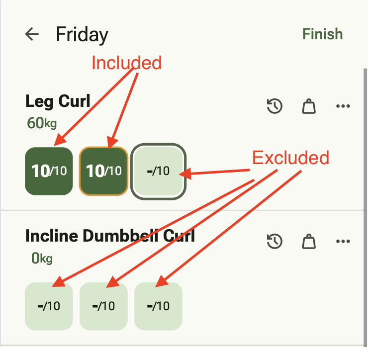

# Plaintext Export

LiftLog supports exporting your data as plaintext. Currently it supports CSV and JSON files.
These exports must NOT be used as a backup mechanism, as LiftLog cannot read these plaintext exports.

To create an export, simply navigate to `Settings -> Export, Backup, and Restore -> Plaintext Export`.
Here, you can export a CSV or JSON file which contains your workout data.


Neither format contains rep targets, progression rules or failure rest. Plans no longer prescribe them;
older data still stores them, but only backups and `.liftlogplan` files carry them.

## CSV

One row per completed weighted set. Sets that were never checked, and cardio exercises, are left out.

```csv
SessionId,Timestamp,Exercise,Weight,WeightUnit,Reps,Notes
b59ab47f-8955-4a23-afa3-5d472dacc575,2024-10-16T10:45:06,Incline Dumbbell Bench Press,60,kg,8,
8b929966-2426-4cbf-b678-ac8e811c8b2b,2024-10-16T10:44:39,Bench Press,67.5,kg,12,
8b929966-2426-4cbf-b678-ac8e811c8b2b,2024-10-16T10:44:38,Bench Press,67.5,kg,12,
95bf84cb-1f11-4d51-ba6e-a4c3f1e40b08,2024-10-16T10:43:50,Pull-ups,84,kg,7,
9c67f65a-3099-4d6b-b04d-428ce386f61d,2024-10-16T10:43:41,Squats,97.5,kg,8,
```

An exercise that tracks no load leaves `Weight` and `WeightUnit` empty.

## JSON

An array of sessions, each with its `id`, `date`, `bodyweight`, workout `blueprint` (`name` and `notes`)
and `recordedExercises`. Every set is included, checked or not; an unchecked set has no `set`.

A weighted exercise looks like this:

```json
{
  "type": "RecordedWeightedExercise",
  "blueprint": {
    "type": "WeightedExerciseBlueprint",
    "name": "Deadlift",
    "sets": 3,
    "resistance": "external",
    "restBetweenSets": { "minRest": "PT1M30S", "maxRest": "PT3M" },
    "supersetWithNext": false,
    "notes": "",
    "link": ""
  },
  "potentialSets": [
    {
      "weight": { "value": "180", "unit": "kilograms" },
      "set": { "repsCompleted": 5, "completionDateTime": "2024-01-15T10:00:00Z" }
    }
  ],
  "notes": "felt strong"
}
```

`blueprint.sets` is how many sets the plan asked for; `potentialSets` also holds any sets added during
the workout. Cardio exercises are exported as the app stores them.
